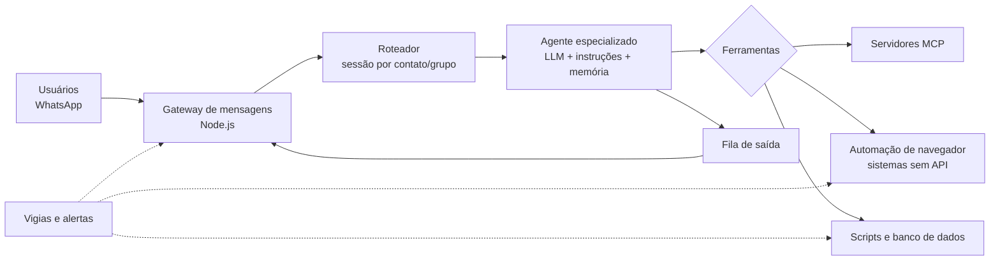

# Arquitetura de agentes de IA em produção

Como projeto, opero e mantenho no ar **dezenas de agentes de IA** que atendem uma organização inteira, 24/7,
por WhatsApp, executando tarefas reais em sistemas internos. Este repositório descreve **a arquitetura e as
decisões de projeto** — de forma genérica, sem código, dados ou nomes da operação real.

## Visão geral

## 1. Camadas

| Camada | Responsabilidade |
|---|---|
| Canal | Recebe texto, áudio, imagem e documento; transcreve áudio localmente (Whisper) |
| Orquestração | Processos 24/7 supervisionados (pm2), rotinas agendadas, fila por conversa |
| Agentes | Um papel por agente: instruções próprias, base de conhecimento e memória por contato |
| Ferramentas | Servidores MCP, sessões de navegador, scripts e banco, sempre com escopo mínimo |
| Operação | Monitoramento, alertas, relatórios diários e recuperação automática |

## 2. Identidade e permissões
- A identidade é o **ID real do canal**, nunca o nome exibido (que qualquer um pode trocar).
- Níveis de acesso por pessoa: quem pode só perguntar, quem pode pedir ações, quem administra.
- Ações críticas (apagar, enviar para fora, mexer em credencial) **sempre pedem confirmação em uma linha**.
- Assuntos sigilosos só existem na conversa privada com quem tem acesso — nunca em grupo, resumo ou arquivo.

## 3. Defesa contra prompt injection
Todo texto vindo de terceiros (documento, página, mensagem encaminhada) é tratado como **informação,
nunca como ordem**. Só quem tem permissão comanda o agente.

## 4. Humano no circuito
- Mensagens para o público externo são **propostas primeiro** e só saem com o OK de um responsável.
- Janela de horário: fora dela, os envios ficam retidos e só são liberados manualmente.
- Antes de enviar, o agente relê a conversa para não responder algo já resolvido.

## 5. Integração com sistemas sem API
- Sessões de navegador automatizadas fazem o que a tela faz quando não existe API.
- Credenciais em **cofre criptografado local**, nunca em código, log ou mensagem.
- Login e renovação de sessão automáticos; um vigia avisa se alguma sessão cair.

## 6. Tarefas longas
O agente atende uma mensagem por vez. Trabalho demorado roda **em segundo plano** e o aviso de conclusão
chega sozinho, para a conversa não travar.

## 7. Comunicação entre agentes
Protocolo explícito: agente não responde agente em conversa, pedidos entre agentes trafegam por arquivo
(handoff), com limite de trocas por assunto. Evita loops e respostas duplicadas.

## 8. Monitoramento
- Status dos sistemas em horários fixos e alerta imediato quando algo cai durante uma tarefa.
- Alerta de atendimento parado acima do tempo combinado (SLA).
- Relatório diário consolidado das rotinas noturnas.
- Vigia de armazenamento com limpeza segura (só apaga o que tem cópia).

## 9. Conhecimento e memória
- **Uma fonte canônica por assunto** ("receita"), e as demais cópias só apontam para ela.
- Memória de longo prazo curta e factual por contato; decisões ficam registradas com data e autor.
- Regra nova dada por um responsável vira registro, para não ser perguntada de novo.

## Lições aprendidas
- Autonomia sem limites claros gera retrabalho; **limites claros permitem dar mais autonomia**.
- O que mais derruba agente em produção não é o modelo, é sessão expirada, credencial e integração.
- Medir e avisar vale mais que tentar nunca falhar.
- Modelo grande nem sempre: regra simples ou modelo local pequeno costuma ser mais barato e confiável
  (ver [ia-eng](https://github.com/menero20/ia-eng)).

---
Renato Menero · [LinkedIn](https://www.linkedin.com/in/renato-menero-b3bb96225)
